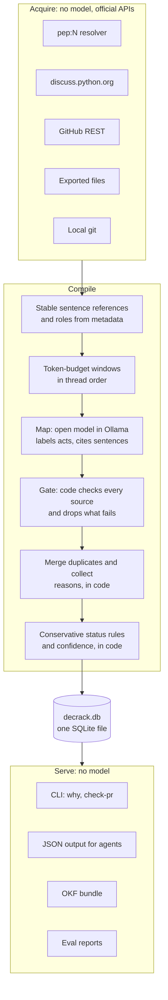
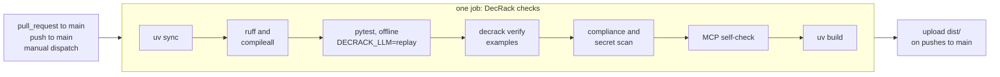

# DecRack

**Decision memory for open-source projects: a small terminal tool for decisions, powered by local open models. No web UI.**

[](https://github.com/Madhav-GPT/DecRack/actions/workflows/ci.yml)
[](LICENSE)

DecRack is an open-source Python package that gives AI coding agents a project's decision history. Point it at a public discussion, and a small open-weight model running locally in Ollama turns the thread into **decision records**: what was being decided, which options were considered, which were accepted or rejected, and why. Every claim links to the exact sentences it came from. Code checks that the cited text exists and whether it states a decision; an optional model check asks whether it supports the claim.

Type a link and a question into `decrack chat`, and it answers from numbered, cited decision cards. Coding agents use the same engine through DecRack's MCP server, or through the CLI and [`AGENTS.md`](AGENTS.md).

**Measured, honestly.** Every quote in the four committed real runs re-checks against its source post (`decrack verify examples`: 256 quotes, OK). `support: unverified` on a card means only that the optional model support check didn't run. On the withheld-PEP test the 1.5B model recovers 1 of 22 rejected ideas, and [Evaluation](#evaluation-the-withheld-pep-test) traces exactly where the rest are lost. No Ollama? `uv run pytest -q` and `uv run decrack verify examples` run fully offline.

> **Context7 gives agents library docs. DecRack gives agents a project's decisions and rejected ideas.**

Team Allied · Hacktoberfest 2026 Hack Day Sonipat · Problem Statement 6: Open Source Decision Intelligence and Knowledge Recovery

**Contents:** [Problem](#the-problem) · [What it does](#what-decrack-does) · [OKF and RAG, plainly](#okf-and-rag-plainly) · [How it works](#how-it-works) · [Checking claims](#how-decrack-checks-its-claims) · [Quickstart](#quickstart) · [Two ways to use it](#two-ways-to-use-decrack) · [CLI](#cli-reference) · [Input checks](#input-checks) · [Outputs](#outputs) · [Evaluation](#evaluation-the-withheld-pep-test) · [CI/CD](#cicd) · [Structure](#project-structure) · [Principles](#design-principles) · [Team](#team)

More detail: [Architecture](docs/ARCHITECTURE.md) · [Testing runbook](docs/TESTING.md) · [OpenCode, MCP and agents](docs/OPENCODE.md) · [AGENTS.md](AGENTS.md) · [Demo script and Q&A](docs/DEMO.md) · [Examples](examples/README.md)

---

## The problem

Open-source projects make their decisions in public, and then the reasoning gets buried. A single PEP discussion on discuss.python.org can run to hundreds of posts, split across several topics. Almost nobody re-reads that before opening a pull request, so rejected ideas come back and maintainers argue them all over again.

AI coding agents make this worse. An agent can read the code and the library docs, but not the 300-post thread in which the maintainers rejected the approach it is about to implement. It has no way to ask "was this already tried, and why was it rejected?"

PEPs at least end with a *Rejected Ideas* section. Most projects have nothing like it: their decisions live only in issues, review comments and forum threads.

The hackathon's official test makes the problem concrete. The organizers hand over a PEP's discussion **without the PEP**, and the system has to recover the rejected ideas and the reasons for rejecting them.

### What PS6 asks for, and where DecRack does it

| PS6 asks the system to… | How DecRack does it |
|---|---|
| 1. Analyze public discussions, issues, pull requests and technical threads | Connectors for discuss.python.org, GitHub issues and PRs, exported files, and a `pep:N` resolver |
| 2. Extract decisions and their reasoning | Decision records: the question, the options, each option's status and its cited reasons |
| 3. Identify rejected alternatives and explain why | Conservative status rules say what was rejected, by whom and how firmly (`confirmed`, `inferred`, `contested`, `unresolved`); every reason cites the sentences it came from |
| 4. Link decisions to the relevant source code | A `code_links` table built from exact facts only: files the thread names (`direct`), and files a PR changed or `git blame` points to (`historical`) |
| 5. Maintain references to the original discussions | Every citation is a stable reference (post ID, version, sentence offsets) with a link to the post |
| 6. Surface past decisions when a new PR modifies related code | `decrack check-pr`, which people run on a PR and agents run before finishing a change, reporting related history and possible conflicts |
| 7. Preserve traceability so maintainers can verify every decision | Source validity and decision authority checked by code on every claim, an optional semantic support check, `decrack verify` in CI, and every model call stored with its prompt and response |

---

## What DecRack does

1. **Input.** Point it at a public discussion: a PEP thread on discuss.python.org (`pep:830` finds the thread for you), a GitHub issue or pull request, or an exported file. Or give it a whole GitHub repo and a question: `decrack ask` finds the matching issues and PRs itself.
2. **Extraction.** A small open-weight model running **locally in Ollama** (`qwen2.5:1.5b`, about 1 GB) reads the thread, and deterministic code turns what it finds into decision records. Each record holds what was being decided, which options were considered, which were accepted or rejected, and why. Every claim cites the sentences it came from, and every citation is checked before it is kept.
3. **Use.** Ask in your own terminal with `decrack chat`, or let your agent ask "was this approach already rejected, and why?" before it writes code. **OpenCode** and other MCP harnesses use DecRack's MCP server, and any agent that runs shell commands can follow [`AGENTS.md`](AGENTS.md). `decrack check-pr` flags pull requests that touch code with recorded decisions.

DecRack lives where developers already work:

- **in the terminal**, as an interactive `decrack chat` and a CLI;
- **in the agent**, through the MCP server, or the CLI and an [`AGENTS.md`](AGENTS.md) instruction file;
- **in the repo**, as a markdown knowledge bundle in Google's [Open Knowledge Format](https://github.com/GoogleCloudPlatform/open-knowledge-format) (OKF) with a [MADR](https://adr.github.io/madr/)-style body;
- **in CI**, as a pull request check.

> **Where the open model does the work.** Two jobs, both on DecRack's own code path, with an open-weight model in a local Ollama:
>
> - **Compiling discussions: the map step.** For each window of the thread, the model labels what each post does, names the alternatives and cites the sentences. Merging duplicates, status, reasons, search, the OKF export and `check-pr` are all deterministic code.
> - **Writing the chat answer.** In `decrack chat`, the model writes the answer from the cited evidence only.
> - **The model is detected automatically.** DecRack uses the model you name with `--model` if it's installed, otherwise `qwen2.5:1.5b`, otherwise any model the local Ollama runs; cloud-hosted models are skipped. If Ollama isn't running or no model is installed, it stops and prints the exact fix. It only ever talks to the local Ollama.
> - **Two optional model steps, both off by default:** the support check (`--support-check`) and the evaluation's closed-book baseline (`--closed-book`).
> - **Bigger open models still work** through `--model`.
> - **Only local models.** DecRack never calls a hosted model. Every run in [`examples/runs/`](examples/) was produced by the local model, and each run's `run.json` records the model tag, its digest and the Ollama version.
> - **The agent never extracts.** An agent's own model calls DecRack's MCP tools or CLI; it never does the extraction.

### An example decision card

*Illustrative only. This is the synthetic eight-post "PEP 9999: Lazy widgets" thread that the test suite uses (`tests/conftest.py`), not a real discussion, and the layout is simplified. Real outputs produced by the model are in [`examples/runs/`](examples/).*

```text
$ decrack why "decorator"

dr-1acb7d33 · PEP 9999: Lazy widgets · 4 options: 1 accepted, 3 rejected

  REJECTED  Use a decorator instead of a new keyword    confirmed · author statement · high
            Decorators cannot apply to import statements.
            "We rejected the decorator approach because decorators cannot apply to import statements."  [p5.s2]

  REJECTED  Global flag to enable laziness everywhere   confirmed · author statement · high
            It changes behaviour for every library at once.
            "The global flag is also rejected since it changes behaviour for every library at once."  [p5.s3]

  REJECTED  Hard lazy keyword                           confirmed · decider statement · high
            It breaks existing code that uses lazy as a name.
            "The hard keyword is rejected because it breaks existing code."  [p8.s2]

  ACCEPTED  Soft keyword                                confirmed · decider statement · high
            It keeps lazy usable as a normal name.
            "The Steering Council accepts PEP 9999 with the soft keyword."  [p8.s1]
```

- **Each option line** shows the status, the status kind, the basis and the confidence.
- **`[p5.s2]` is a display alias:** sentence 2 of post 5. Behind it, the record stores the post's stable ID, its version and the sentence's character offsets, so the quote is always an exact slice of what the poster wrote.
- **This card is compact on purpose.** `decrack show <id> --detail evidence` expands it with each cited post and its neighbours.
- **The authority rules at work:** the author proposed the hard keyword in post 1, and a decider rejected it in post 8 in explicit decision language ("is rejected").

---

## OKF and RAG, plainly

DecRack is not "RAG over your code", and it is not a knowledge graph:

1. **No RAG over code.** DecRack never embeds the codebase or asks a model to "understand" it.
2. **Compile, once per discussion.** An open model reads the *discussion* and extracts decisions, options and reasons as structured records, each citing exact sentences. That is information extraction.
3. **Store.** Records, raw posts per version, citations and code links are rows in one SQLite file. Code is linked only by exact git facts (which PR changed which file, `git blame`) and by file paths the thread names. There is no graph database.
4. **Export.** OKF is just a **file format**: one markdown file per decision, with frontmatter holding sources, provenance and verification state. It doesn't retrieve or reason. A markdown viewer such as Obsidian can draw its links as a graph, but that is the viewer's feature.
5. **Retrieve, with no model.** Exact and keyword search over records, file paths and PR numbers returns a small evidence packet.
6. **Explain, outside DecRack.** If you want prose, your agent writes it from that cited evidence.

**In one line:** *"An open model compiles discussions into verified decision records once. Code is connected by git facts, not embeddings. OKF is just the file format we export. Lookups are exact search, and any explanation is written by your agent from cited evidence."*

---

## How it works

DecRack is one Python package with three stages, **Acquire → Compile → Serve**, around one SQLite file. There is no server to run and no agent loop.



**Acquire** uses official APIs, never HTML scraping, and no model:

- **Local files**, for exported threads.
- **discuss.python.org** (or any Discourse forum): one request (`/t/{id}.json?print=true`) returns a whole topic with its metadata.
- **GitHub REST**: issues, pull requests, reviews and changed files, read with a read-only `GITHUB_TOKEN`.
- **`pep:N`**: uses the PEP index only to find the PEP's discussion threads, and merges them into one thread. It never fetches the PEP text, and the PEP's status and resolution never reach a prompt. That is the leak guard for the evaluation.
- **Local git**, for linking decisions to code and following renames, and, with `check-pr --blame`, for blaming the lines a change touches.

Every post keeps a stable, source-native ID and version, and every sentence keeps its character offsets. So citations survive re-merged topics, new replies and edits, and an edited post marks its old citations `source_changed` instead of silently re-pointing them.

**Compile** lets the model read and lets code decide:

1. **Split** every post into sentences with character offsets. Prompts use short aliases (`p12.s3`); storage uses stable references.
2. **Assign roles** from metadata, never from what a post claims:
   - **author**: the person who opened the thread or PR;
   - **decider**: the Steering Council group on discuss.python.org, or a GitHub maintainer who merges or closes;
   - **maintainer**;
   - **participant**: everyone else.
3. **Cut windows** in thread order by token budget: 3,000 tokens each, overlapping by about 300 tokens (rounded to whole posts). Oversized posts are split at sentence boundaries.
4. **Map** (the open model, one call per window, and its only job by default):
   - name the alternatives;
   - label each post's act: propose, support, object, accept, reject, defer or withdraw;
   - give the reason the post states;
   - cite the sentences it relies on.

   Each map item is `{alt_ref, alternative, act, reason or null, cites}`, and each window also sees the alternatives found so far.
5. **Gate** (code): resolve every citation to a stable reference, check it against that post version, and slice the quote from the post. Drop anything that fails.
6. **Merge** duplicate alternatives, in code. Two names count as the same alternative when their difflib ratio is at least 0.85, or their token Jaccard similarity is at least 0.6.
7. **Collect the cited reasons** per option, in code, and label each piece of evidence (decision, objection…) from the decision cues in its cited sentences.
8. **Support check** (optional, off by default; turn it on with the global `--support-check` flag): a batched model call asks whether the cited sentences support each claim. With it off, records say `support: unchecked`.
9. **Apply the conservative status rules** (below), and derive confidence from the evidence, never from the model's opinion of itself.

**Serve** never waits for a model. Searches, `show`, the OKF bundle, the PR check and the eval reports all read the same SQLite file.

The full design, with diagrams of every stage, is in [docs/ARCHITECTURE.md](docs/ARCHITECTURE.md).

---

## How DecRack checks its claims

"Verified" means three different things, so DecRack checks and reports them separately:

| Property | The question | How it is checked |
|---|---|---|
| **Source validity** | Does the cited text exist, in this version of the post? | Deterministic code: the citation resolves to a stable post ID and version, the hash matches, and the quote is exactly that slice of the post. Citations that fail are dropped. |
| **Semantic support** | Do the cited sentences actually support this claim? | **Optional, off by default** (`decrack --support-check …`). A batched model call sees only the claim and its cited sentences, and answers `supported`, `partial` or `unsupported`. With the check off, records say `support: unchecked`, never "verified". |
| **Decision authority** | Is this a decision, or an opinion, objection or suggestion? | Deterministic code: explicit decision language in the cited sentence (matched against a fixed cue list), the speaker's role from metadata, and the status rules. Metadata alone never makes something a decision. |

**Status kinds.** Each option has a status (accepted, rejected, deferred…) and a separate `status_kind` that says how firmly the thread establishes it:

- **`confirmed`**: an accept, reject, defer or withdraw by the thread author or an identified decider, where the cited sentence uses **explicit decision language** from a fixed cue list, such as "rejected", "added to rejected ideas", "we will not", "decided", "accept" or "withdraw".
- **`inferred`**: the author's objection or rejection without that language, with no later backing from the author or a decider. Or objections from at least two participants with no backing from the author or a decider; this case is weaker and shown with a note.
- **`contested`**: a later statement from the author or a decider points the other way, with no explicit resolution.
- **`unresolved`**: everything else.

**Recency.** A later statement takes over only if it uses explicit decision language about that option and comes from the same or higher authority. A later authoritative post that disagrees without settling it makes the option `contested`.

**Support verdicts.** When the support check runs, a claim it judges `unsupported` is downgraded from `confirmed` to `inferred`.

**Confidence** is derived in code from the status kind and its evidence, never asked of the model.

---

## Quickstart

A base laptop is enough. DecRack runs on a base M4 MacBook Pro with 16 GB, and needs about 2 GB of disk, about 1 GB of it for the model. DecRack isn't on PyPI; you install it straight from GitHub.

```bash
# 1. Install uv and Ollama (https://ollama.com/download), then pull the model (about 1 GB)
curl -LsSf https://astral.sh/uv/install.sh | sh
ollama pull qwen2.5:1.5b

# 2. Install DecRack
uv tool install git+https://github.com/Madhav-GPT/DecRack

# 3. Check the setup: Ollama, the installed models and opencode
decrack doctor

# 4. Start the chat (plain `decrack` on a terminal does the same)
decrack chat
```

Then type a link and a question in plain words:

```text
Using qwen2.5:1.5b (local, open-weight via Ollama)
I answer questions about engineering decisions in a discussion: what was proposed, what was rejected or accepted, and why. Give me a link (a GitHub repo, issue or PR, a discuss.python.org thread, or pep:NNN) and a question.
decrack> https://github.com/astral-sh/uv/issues/2077 why didn't uv add pip's --user flag?
decrack> what else was rejected?
decrack> /show gh:astral-sh/uv#2077
decrack> /check-pr https://github.com/owner/repo/pull/456
decrack> /quit
```

- **What the chat does.** It runs the input checks and compiles the discussion with the local open model.
- **The answer.** It lists numbered cards, each as `[n] title | status (status_kind) | reason | "quote" | link`. Then comes *Answer (model, from cited evidence):* with the answer and its sources. That is one model call, from those cards only.
- **A link with no question** gives a summary: the threads it read, each one's outcome, and the top rejected ideas with links.
- **Links.** Without a link, it asks for one. A follow-up question reuses the last link.
- **Commands.** `/show <decision id>` shows a full record, and also takes a thread ID such as `pep:830`. `/check-pr <PR URL>` checks a pull request, `/help` lists the commands, and `/quit` leaves.
- **No match.** If no recorded decision matches, it says *No recorded decision about that in these threads.*; with no cards, there is no model call.

**The same answers without the chat:**

```bash
decrack ask pep:830 "was attaching timestamps through exception notes rejected?"
decrack show pep:830 --detail evidence
```

- **A question about a whole repo.** `decrack ask` also takes an issue URL or a repo URL. Given a repo, it searches that repo's issues and PRs for the question's keywords and reads the top 3:

  ```bash
  uv run decrack ask https://github.com/astral-sh/uv/issues/2077 "why didn't uv add pip's --user flag?"
  uv run decrack ask https://github.com/astral-sh/uv "why didn't uv add pip's --user flag?"
  ```

  GitHub sources need a `GITHUB_TOKEN` on a shared network.
- **No question?** `decrack ask https://github.com/owner/repo` on its own stops with *Tell DecRack what you want to know, e.g. decrack ask https://github.com/owner/repo "why not X?"*, and exits with code 2.
- **Follow-ups.** `uv run decrack why "exception notes"` searches everything compiled so far, and `uv run decrack run <source>` compiles a discussion without asking anything.

- **Timing (measured, from each `run.json`).** On a base M4 with 16 GB, compiling PEP 830, 799 and 806 took 47 s, 40 s and 22 s. A 97-comment GitHub issue takes about a minute the first time; re-runs are cached.

  Every model call is cached by a hash of its exact inputs, so a second run makes no model calls.
- **Other models.** DecRack picks `qwen2.5:1.5b` if it's installed, otherwise any model in your local Ollama. To choose one yourself, pass `--model TAG` before the command.
- **From a clone.** `git clone https://github.com/Madhav-GPT/DecRack.git && cd DecRack && uv sync`, then prefix the commands with `uv run`.
- **Context length.** Ollama's default context is only 4K tokens on machines with less than 24 GiB of VRAM. DecRack sets the context size on every request (`num_ctx`, 8,192), so its own calls are not cut short. [docs/TESTING.md](docs/TESTING.md) covers this and other setup issues.

---

## Two ways to use DecRack

**1. In your own terminal: `decrack chat`.** Type a link and a question in plain words, and read numbered, cited decision cards (see the quickstart).

- **It stays on topic.** The chat accepts normal prompts, but only about decisions in a linked discussion.
- **Its scope line.** With no link, with off-topic text, or when nothing matches, it replies: *"I answer questions about engineering decisions in a discussion: what was proposed, what was rejected or accepted, and why. Give me a link (a GitHub repo, issue or PR, a discuss.python.org thread, or pep:NNN) and a question."*
- **No free chat.** It never free-chats, and the model answers only from the maintainers' own words and the cited cards.

**2. Any MCP harness, such as OpenCode.** Install DecRack with `uv tool install git+https://github.com/Madhav-GPT/DecRack`, then add it to `opencode.json`:

```json
{"mcp": {"decrack": {"type": "local", "command": ["decrack", "mcp"], "enabled": true, "timeout": 600000}}}
```

The agent then gets DecRack's MCP tools: `ask`, `search_decisions`, `get_decision`, `decisions_for_files`, `check_change` and `search_evidence`, plus the `review_with_history` prompt.

**With a small local model, use the DecRack agent.** This repo's [`opencode.json`](opencode.json) adds a `decrack` agent (press Tab) whose only tool is `ask`, plus a `/why` command, so even `qwen2.5:1.5b` calls DecRack instead of answering from memory. Larger models usually pick `ask` on their own, because its description starts *"Call this first when the user asks why something was decided, rejected or accepted and gives a link"*. For example:

- *"Use DecRack on https://github.com/astral-sh/uv/issues/2077: why didn't uv add pip's --user flag?"*
- *"Use DecRack on https://github.com/owner/repo. Why didn't they add X?"*
- *"I'm about to edit `src/widgets/config.py`. Ask DecRack which recorded decisions cover that file."*

**The CLI alternative: `AGENTS.md`.** An agent without MCP can run the same CLI. Copy [`AGENTS.md`](AGENTS.md) to your project root. It tells the agent to:

- require a source and a question;
- run `decrack ask … --format json`;
- check `decrack show <id> --detail evidence --format json` before claiming anything;
- quote only DecRack's text, report status kinds honestly, and relay DecRack's error and fix messages as they are.

The [agent guide](docs/OPENCODE.md) covers both setups, running OpenCode on a local open model, and troubleshooting.

---

## CLI reference

```text
decrack [--db PATH] [--model TAG] [--ollama-host URL] [--support-check] COMMAND [ARGS]
```

The global options go **before** the command, for example `decrack --db demo.db run pep:830` or `decrack --support-check run pep:830`. There are twelve commands; most people only need `chat`.

`REF` is any of:

- `pep:830` (or `PEP 830`);
- a Discourse topic URL, such as `https://discuss.python.org/t/106942`;
- a GitHub issue or pull request URL, or `owner/repo#123`;
- a path to an exported file.

| Command | What it does | Model |
|---|---|---|
| `decrack chat` (or plain `decrack`) | The interactive terminal. Type a link and a question; it answers from numbered, cited decision cards. With no link, it asks for one, and follow-ups reuse the last link. It also takes `/show <decision id>`, `/check-pr <PR URL>`, `/help` and `/quit`. | yes |
| `decrack ask SOURCE ["QUESTION"] [--max-threads N] [--format md\|json]` | Answer a question with cited decision cards. SOURCE is anything `run` accepts, or a GitHub repo URL, which needs a question. For a repo, DecRack searches its issues and PRs with the question's keywords (stopwords removed, at most 6). It runs the top N matches (default 3, at most 5), skips threads with nothing to analyze, and says which threads it read. Cached model calls are reused. | yes |
| `decrack ingest REF` | Fetch a discussion and store its posts, without compiling | no |
| `decrack run REF [--out DIR]` | Fetch a discussion and compile it into a decision record. This is how every new discussion gets in. With `--out`, it also writes the run folder (`thread.json`, `records.json`, `run.json`) to DIR. | yes |
| `decrack why QUERY [--limit N] [--raw] [--format md\|json]` | Search the records and print compact decision cards with links. If QUERY is a file path, it lists the decisions linked to that file. With `--raw`, it searches the raw stored posts instead: uncompiled and unchecked, the fallback when no record matches. | no |
| `decrack show ID [--detail card\|full\|evidence] [--budget-tokens N] [--format md\|json]` | Show one decision record. ID is a decision ID, or a thread ID such as `pep:830`. `card` is the compact card; `full` adds every option with its reasons and checks; `evidence` also adds each cited post, its reply parent and the next reply, within the token budget. Agents read this before they claim anything. | no |
| `decrack check-pr [PR_URL] [--paths P ...] [--diff BASE..HEAD] [--repo DIR] [--blame] [--description TEXT] [--format md\|json]` | Report related history and possible conflicts for the files a change touches: recorded decisions, their rejected options and the evidence. `--blame` also walks `git blame` on the changed lines back to the PRs that last touched them. It prints the report and never posts anything. | no |
| `decrack export okf --out DIR` | Write the OKF + MADR markdown bundle | no |
| `decrack export calls --out FILE` | Export the recorded model calls as JSONL, for the offline tests to replay | no |
| `decrack eval REF ... --gold eval/gold [--out examples/runs] [--closed-book]` | Run the withheld-PEP evaluation. It writes one run folder per PEP plus `eval-summary.md` and `eval-summary.json`, to `examples/runs` by default. Matching against the gold is deterministic fuzzy matching, and `matches.json` lists every pair for human review. `--closed-book` adds the optional baseline run. | yes |
| `decrack verify DIR` | Re-check every quote of every run folder under DIR against its thread. Under `examples/runs` it also refuses any folder whose `run.json` isn't a live model run. | no |
| `decrack mcp` | Start the MCP server on stdio, for OpenCode and other MCP harnesses | only `ask` |
| `decrack doctor` | Check Ollama, the installed model and `opencode`, and say how to fix anything that fails. It ends with the two commands to tell your agent: `decrack run <URL>`, then `decrack why "<question>" --format json`. | no |

By default the model runs only the map step. Two extra model steps are optional and off by default: the global `--support-check` (the semantic support check) and `eval --closed-book` (the eval's baseline).

**Global options**

| Option | Meaning | Default |
|---|---|---|
| `--db PATH` | SQLite database file | `decrack.db` |
| `--model TAG` | Ollama model tag used for extraction. Bigger open models work too. | `qwen2.5:1.5b` if installed, otherwise any installed model |
| `--ollama-host URL` | Where Ollama is listening. This flag is the only way to change it. | `http://127.0.0.1:11434` |
| `--support-check` | Turn on the optional semantic support check | off |

**Environment.** Settings are these flags plus three environment variables; there is no config file.

- `GITHUB_TOKEN`: a read-only token, needed for GitHub sources. Anonymous requests are limited to 60 an hour per IP, which a shared venue network exhausts quickly.
- `DECRACK_DB`: the database file, if you'd rather not pass `--db` each time.
- `DECRACK_LLM=replay`: answer model calls from the test recordings (`tests/fixtures/llm_calls.jsonl`) instead of Ollama. Tests and CI use this.

---

## Retrieval for people and agents

Retrieval is **compact first, then expand**: `why` returns short cards, and `show --detail evidence` adds the evidence only when someone needs it. `--format json` gives agents the same results as structured data.

- **No model runs on a lookup.** `why`, `show` and the read-only MCP tools only read the database. In `decrack chat`, the local model writes the answer from the cited cards only.
- **No age decay.** A ten-year-old rejected idea can be the most relevant record there is. Age is shown, never used to down-rank. Whether a record still applies comes from its code links (does the linked path still exist at HEAD?) and from later decisions.
- **Bounded output.** Results are packed to about 10K tokens.

## MCP tools

`decrack mcp` serves DecRack to OpenCode and any other MCP harness. Agents call these tools:

| Tool | What it does |
|---|---|
| `ask` | Answers a question about a source (a repo URL, an issue or PR URL, a thread, `pep:N` or a file), the same as `decrack ask` |
| `search_decisions` | Searches the recorded decisions and returns compact cards |
| `get_decision` | One record, as a card, in full, or with its evidence |
| `decisions_for_files` | Decisions linked to the files an agent is about to edit |
| `check_change` | The `check-pr` report for a PR URL or a list of paths |
| `search_evidence` | Raw posts, labeled uncompiled, when no record matches |

There is also one prompt, `review_with_history`. Only `ask` runs the local model, to compile what it reads. The other tools are marked read-only. A failed check returns `{"ok": false, "error", "fix"}`.

## Input checks

DecRack checks its input before doing any work, and the model check runs before any search or fetch. When something is wrong, it says so in plain words, with a fix. With `--format json` it prints `{"ok": false, "error": "...", "fix": "..."}`, and agents are told to pass that message on as it is.

| Case | What DecRack tells you | Exit code | Fix |
|---|---|---|---|
| No source | A source is needed: a GitHub issue or PR URL, a discuss.python.org thread, `pep:NNN` or a file | 2 | Give it a source. Agents ask the user instead of guessing. |
| Model not ready | *Ollama isn't running. Install it from https://ollama.com/download, then run: ollama serve*, or *No open model installed. Run: ollama pull qwen2.5:1.5b* | 3 | Do what the message says; check with `decrack doctor` |
| Fetch error | The source or the repo search couldn't be fetched, with the reason (not found, rate limit, network) | 4 | Check the URL, set `GITHUB_TOKEN` for GitHub, or wait out a rate limit |
| Nothing to analyze | The source has no posts to read, for example an empty thread or only a pasted PEP | 0 | Check the reference, or pick another thread |
| Empty query | No question or file path was given | 2 | Pass a question, a file path, or `--raw` with some text |
| No question for `ask` | *Tell DecRack what you want to know, e.g. decrack ask https://github.com/owner/repo "why not X?"* | 2 | Add the question in quotes |
| No search hits | *No issues or PRs in owner/repo match: (keywords).* | 1 | *Try other words, or give an issue URL.* |
| Empty database | No decisions are recorded yet | 1 | Run `decrack run <source>` first |

**JSON output for agents.** Successful calls print `"ok": true`, with these shapes:

- **`ask`:** `{"ok": true, "source", "question", "keywords", "threads": [{"thread_id", "url", "decision_id"}], "results": [cards in the same shape as why]}`
- **`why` (and `why <path>`):** `{"ok": true, "query", "raw": false, "results": [{"decision_id", "title", "outcome", "link", "matched", "options": [{"key", "title", "status", "status_kind", "confidence", "reason", "link"}]}]}`
- **`why --raw`:** `{"ok": true, "query", "raw": true, "results": [{"post_id", "thread_id", "seq", "author", "url", "snippet"}]}`
- **`show`:** `{"ok": true, "decision_id", "detail", "text", "card": {…}}` for `card`, or `"record": {…}` (the full record) for `full` and `evidence`
- **`check-pr`:** `{"ok": true, "paths", "prs", "matches", "markdown"}`

---

## Outputs

| Output | Where | What's in it |
|---|---|---|
| Database | `decrack.db` (SQLite) | Threads, posts and their versions, decision records, code links, and every model call with its prompt, response, token counts and timing |
| Decision cards | terminal (`why`, `check-pr`) | Status, status kind, confidence, a one-line reason and links; evidence on request |
| Real runs | `examples/runs/<name>/` | `thread.json` (the input as ingested), `records.json` (what the model and the checks produced), `run.json` (model, digest, Ollama version, settings, source allowlist, timings, calls, tokens) and, for eval runs, `scores.json`. See [examples/README.md](examples/README.md). |
| Evaluation summary | `examples/runs/eval-summary.md` and `eval-summary.json` | The metrics across all evaluated PEPs |
| Knowledge bundle | `decrack export okf --out DIR` (this repo's copy is `examples/okf/`) | One markdown file per decision record, with OKF frontmatter and a MADR-style body (Question, Decision outcome, Considered options, Rejected ideas, Code, Evidence), plus `index.md` and `log.md` |
| PR report | `decrack check-pr` | Related history and possible conflicts for the changed files, as markdown or JSON |
| Test recordings | `tests/fixtures/llm_calls.jsonl` | Recorded model responses that the offline tests replay. They prove the logic, not the model, so they are never presented as evidence. |

---

## Evaluation: the withheld-PEP test

The question is the organizers' own: given only a PEP's discussion, does DecRack recover the ideas the PEP rejected, and the reasons?

**Dev set.** All are recent (2025–2026) discussions on discuss.python.org, and each PEP has at least four rejected-idea headings. Post counts are as of 1 Nov 2026.

| PEP | Title | Posts (topics) | Gold ideas | Role |
|---|---|---|---|---|
| 830 | Add timestamps to exceptions and tracebacks | 29 (1) | 13 | dev: small and dense; the demo thread |
| 799 | A dedicated profiling package | 22 (1) | 4 | dev: naming decisions |
| 806 | Mixed sync/async context managers | 29 (2) | 5 | dev: split across topics; rejected by the Steering Council |
| 836 | JIT Go Brrr: the path to a supported JIT compiler | 84 (1) | 5 | dev: withdrawn; one author sits on the Steering Council |
| 822 | Dedented multiline string (d-string) | 152 (1) | 5 | dev: larger single topic |
| 844 | `public` and `private` builtins | 151 (1) | 5 | stretch: overlaps PEP 842 |
| 842 | Module exports | 318 (3) | 6 | stretch: large, split, withdrawn |
| 810 | Explicit lazy imports | 464 (1) | 16 | control: famous, so models may already know it |

**Gold** comes from each PEP's *Rejected Ideas* section, parsed from a pinned python/peps commit: the subsection heading is the idea, and its first paragraph is the reason. There are 59 items, 43 of them outside the control. Each lives in `eval/gold/pep-NNNN.json` with a `recoverable` flag, which records whether the thread actually discusses the idea. [eval/README.md](eval/README.md) explains how they were built.

**What counts as predicted rejected:** options marked rejected with status kind `confirmed` or `inferred`. Precision is reported per status kind, so the trade between precision and recall stays visible.

**Matching** predictions to gold is deterministic fuzzy matching (string similarity), with no model judge. Each PEP's run folder also gets a `matches.json` listing every predicted-to-gold pair, for a human to review.

**Metrics**

- **Recall**: the share of recoverable gold rejected ideas that DecRack recovers as rejected. This is the main metric.
- **Precision**: the share of DecRack's rejected options that match a gold idea, per status kind.
- **Reason agreement**: whether DecRack's cited reason says what the PEP says.
- **Evidence-backed recall**: recall counting only matches whose citations pass the gate. An idea the model merely remembers cannot come with valid citations from the thread.
- **Evidence outside the opening post**: matches that cite at least one sentence after post 1, because opening posts often restate the PEP.
- **Closed-book baseline** (optional, `--closed-book`): the same model, given only the PEP number and title, lists the rejected ideas it remembers. The gap between this and DecRack's recall shows how much comes from reading the thread.
- **Verification, reported separately:**
  - **citation validity**, the pre-gate pass rate of real model outputs (the rate after the gate is guaranteed by the gate itself, so it isn't a metric);
  - the **support rate**, when the eval ran with `--support-check`;
  - a **human review** of `matches.json`.

**search@5: do we need embeddings?**

- **What it measures.** For each gold rejected idea that DecRack matched, the eval searches all the extracted options, using the idea's PEP heading as the query. The search is the same model-free FTS5 keyword search that serves lookups. The metric (`search_recall_at_5`, shown as "search@5") is whether the right option ranks in the top 5, and `scores.json` lists every miss under `search_misses`.
- **What it shows so far.** search@5 is 1.000, but over a single matched idea, so it can't yet tell whether embeddings would help. If keyword search starts missing ideas that the thread words differently, the plan is vectors inside the same SQLite file (`sqlite-vec` with an open embedding model in Ollama), fused with the keyword results.

**Leak controls**

- **The resolver uses the PEP index only to find discussion URLs.** The PEP's status, resolution and title suffix never enter a prompt, and the run uses the topic titles.
- **Every run records a source allowlist** in its `run.json`: every `(post_id, version, sha256)` given to the model.
- **Pasted PEPs are stripped.** An opening post that pastes the PEP is removed before extraction, and the count is recorded. [eval/README.md](eval/README.md#leak-rules) defines what counts as pasting it.
- **Links to the PEP are refused:** `peps.python.org/pep-…` and the python/peps repository.
- **The gold files are read only by the scorer**, after extraction.

Run it with:

```bash
uv run decrack eval pep:830 pep:799 pep:806 --gold eval/gold --out examples/runs --closed-book
```

This reproduces the committed results: about 2 minutes for the three PEPs on a base M4 with 16 GB, measured in each `run.json`. Gold sets exist for more PEPs in `eval/gold/`.

**Results.** These are real runs of `qwen2.5:1.5b` on a base M4 MacBook Pro, over PEPs 830, 799 and 806; the full table is in [`examples/runs/eval-summary.md`](examples/runs/eval-summary.md).
- **Recall:** the macro recall is **0.026**, 1 of 22 gold rejected ideas.
- **Strict precision:** **0.111**.
- **The closed-book baseline:** **0.144**. That is the same model shown only the PEP's title, and its recall is higher than DecRack's.

**Where recall is lost.** We traced every missed idea through the recorded model calls. 19 of the 22 were never named by the 1.5B model in the map step; the citation gate, the merge and the matcher lost none. The model often repeats one item until it fills its 20-item limit (34 of PEP 830's 44 raw items are duplicates). The other 2 it named but labelled accepted. The one idea it recovered comes with a checked quote. So the bottleneck is the small model's extraction, not the checks; a larger open model (`--model`) or a de-duplicating prompt is the next step. The closed-book number is inflated by loose matches (for example "Add timestamps to database queries" counted for "Timestamp in the Traceback Header Line"); see each `matches.json`. PEP 799's only predicted rejection, "Use a decorator", is the prompt's own example copied by the model: a false positive whose citations are valid but don't support it, which is what the optional `--support-check` is for. There is also a real `decrack run` plus `why` on astral-sh/uv#2077 in [`examples/runs/uv-2077/`](examples/runs/uv-2077/).

---

## CI/CD

The workflow is `.github/workflows/ci.yml`: **one job, "DecRack checks"**. It runs on every pull request to `main`, on pushes to `main`, and on manual dispatch, on `ubuntu-latest` with uv and Python 3.12. It needs no secrets and no model: the tests replay recorded model responses (`DECRACK_LLM=replay`).



| Step | What it proves |
|---|---|
| Lint and compile | `ruff check src tests scripts` passes, and every module byte-compiles |
| Tests | `uv run pytest`: the pipeline logic works end to end, offline, with recorded model responses and saved HTTP payloads |
| Verify example evidence | Every quote in the committed real runs still matches its thread, and every folder under `examples/runs` is a live model run, never replayed or scripted output (`decrack verify examples`) |
| Compliance and secret scan | `scripts/compliance_check.py` finds no closed-model provider names and nothing that looks like a secret |
| MCP server self-check | The MCP server starts over stdio and lists its six tools and its prompt (`python -m decrack.mcp_server --self-check`) |
| Build | The package builds (`uv build`). On pushes to `main`, `dist/` is uploaded as an artifact. |

---

## Project structure

```text
DecRack/
├── src/decrack/
│   ├── models.py         shared data contracts (Pydantic): Thread, Post, Evidence, Option, DecisionRecord, ...
│   ├── config.py         settings: defaults, environment, flags (no config file)
│   ├── text.py           sentence splitting with offsets, hashing, time parsing
│   ├── sources/          Acquire: files, discourse, github, peps (the pep:N resolver)
│   ├── pipeline/         Compile: roles, windows, prompts, llm, extract, gate, support, consolidate, run
│   ├── store.py          SQLite + FTS5: threads, posts, post versions, llm_calls, decisions, code_links
│   ├── search.py         `why`: search and compact cards (`--raw` for raw posts)
│   ├── ask.py            `decrack ask`: input checks, repo search and cited answers
│   ├── chat.py           `decrack chat`: the interactive terminal
│   ├── mcp_server.py     the MCP server for OpenCode and other harnesses
│   ├── linking.py        code links: named paths, PR files, renames, opt-in blame
│   ├── surface.py        `check-pr` reports
│   ├── export_okf.py     the OKF + MADR bundle
│   ├── verify.py         quote re-checks for `verify`
│   ├── evaluate.py       the withheld-PEP evaluation
│   ├── doctor.py         `doctor`
│   └── cli.py            the `decrack` command (Typer)
├── tests/                offline tests; recorded model calls and saved HTTP payloads in tests/fixtures/
├── eval/gold/            gold rejected ideas per PEP, from each PEP's Rejected Ideas section
├── examples/             real outputs only: runs/ (one folder per run) and the okf/ bundle
├── scripts/              helper scripts, including the compliance scan
├── docs/                 architecture, testing runbook, agent guide, demo script
├── .github/workflows/    ci.yml
├── pyproject.toml
├── AGENTS.md             instructions that tell coding agents how to use DecRack
├── HACKATHON.md          the hackathon declaration, including the models used
└── LICENSE               MIT
```

---

## Design principles

1. **No quote, no claim.** Every option and reason cites sentences, and code drops any citation that doesn't resolve to real text in the cited post version. Whether that text supports the claim is checked separately.
2. **Compile once, query cheaply.** The model runs once, when a thread is compiled. Queries, agent lookups and PR checks read stored records.
3. **Code decides structure; the model reads language.** IDs, chronology, roles, windows, status rules and confidence are deterministic code. By default the model does one job: it labels acts, names alternatives and cites sentences.
4. **Metadata suggests authority; evidence establishes the decision.** Who counts as a decider comes from group membership or repository role, and a decision also needs explicit decision language in the cited sentence. A post can't promote itself.
5. **Uncertainty is a valid answer.** `inferred`, `contested`, `unresolved` and low confidence are first-class results. Confidence comes from evidence, never from the model's estimate of itself.
6. **Files are the universal API.** The markdown bundle works with zero integration. The CLI's JSON output adds structured queries on top.
7. **Local, read-only, reproducible.** An open-weight model on your own machine, nothing posted anywhere, and every model call cached by hash.

## Deferred, not abandoned

This version has no UI, on purpose. A web UI, ACP (Agent Client Protocol) harness control, decision timelines and graphs are **deferred, not abandoned**. The core library is UI-agnostic, and everything sits behind a clean core/adapter boundary: the CLI, `decrack chat` and the MCP server are already adapters over it, and a web UI would be one more.

## Limitations

- **Small models miss things.** Recall is measured on the dev set, not assumed. A miss shows up as a lower score, and any claim without a valid citation is dropped.
- **The 1.5B default trades accuracy for laptop speed:** it extracts few alternatives per thread, so recall is low. Every claim it makes is still citation-checked, and larger open models can be used with `--model`.
- **The support check is optional and off by default,** so records usually say `support: unchecked`. When it runs, its verdicts are model judgments.
- **Informal threads give less certainty.** A thread where nobody with authority decides explicitly yields `inferred`, `contested` or `unresolved` options.
- **Code links are file-level, not function-level.**
- **No identity merging.** DecRack doesn't merge one person's GitHub and discuss.python.org accounts. It never guesses identity from similar names.
- **Tokens and reach.** GitHub sources need a token on shared networks. DecRack reads public discussions only, and never posts to them.

## Team

Team Allied: **Madhav Gupta, Aish Sagwal, Kabir Vashisht and Akshara Verma.**

## License

[MIT](LICENSE)
